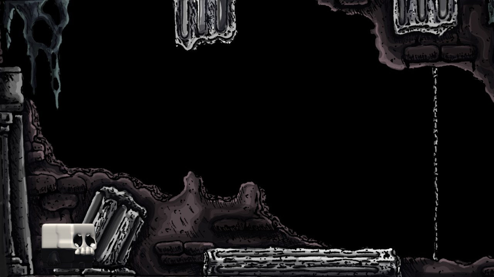
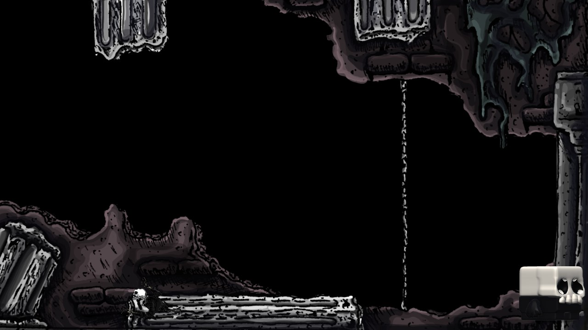
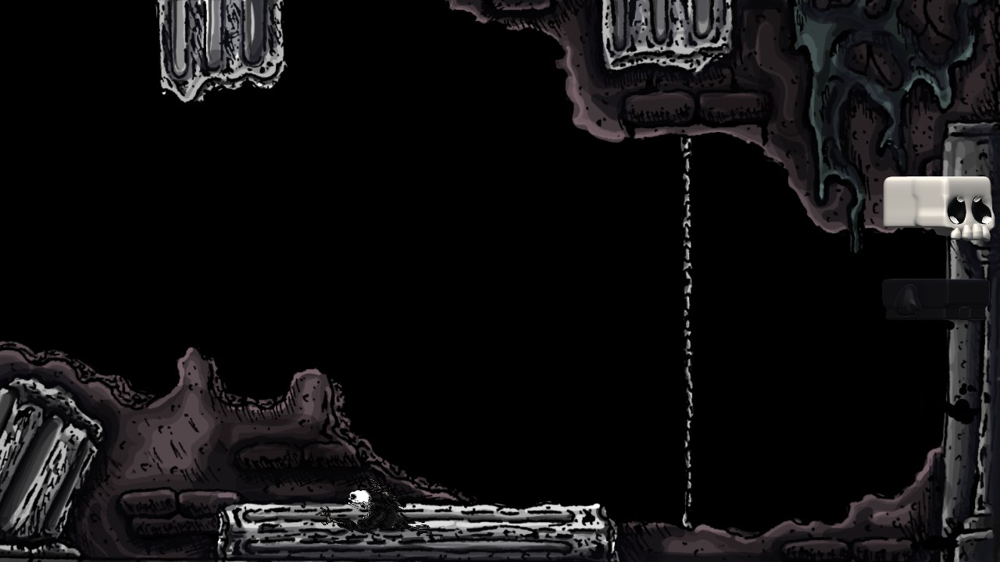
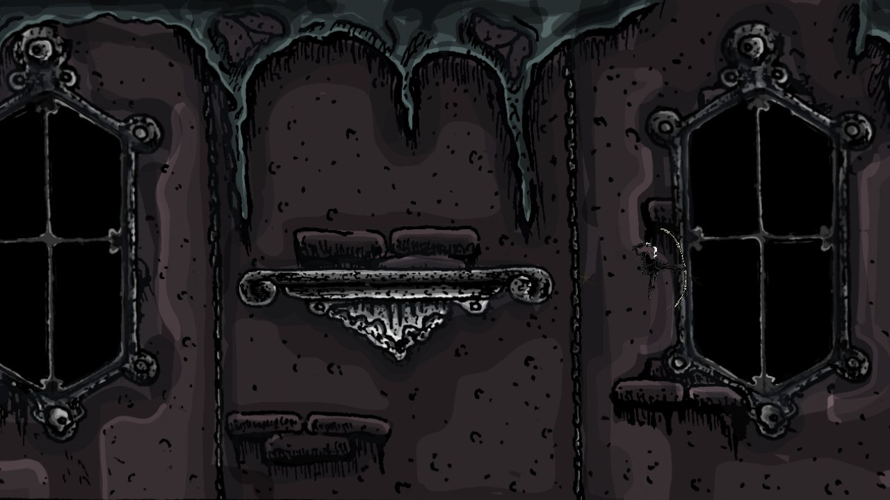
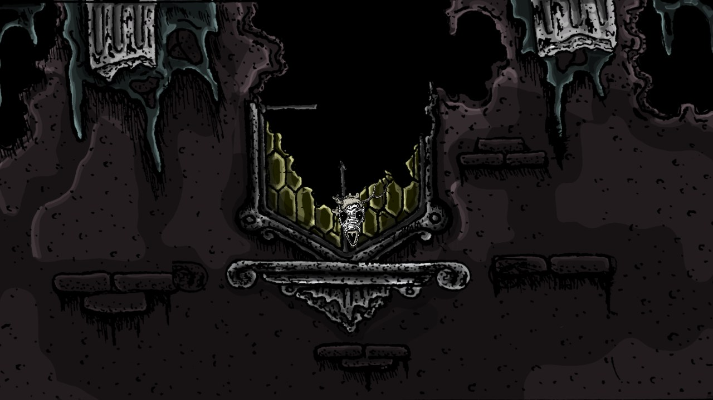
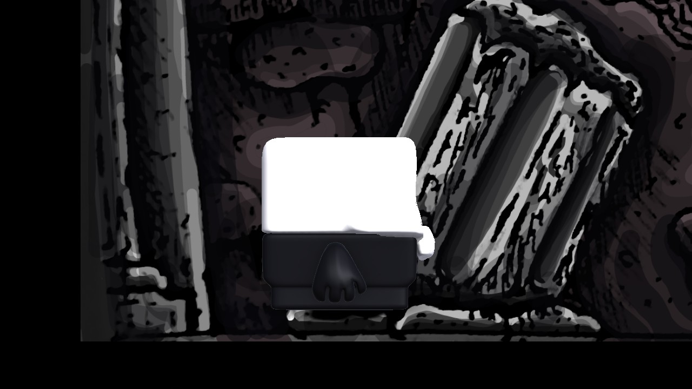
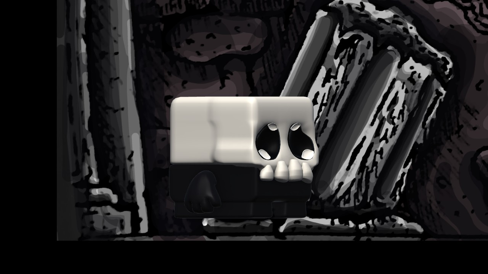
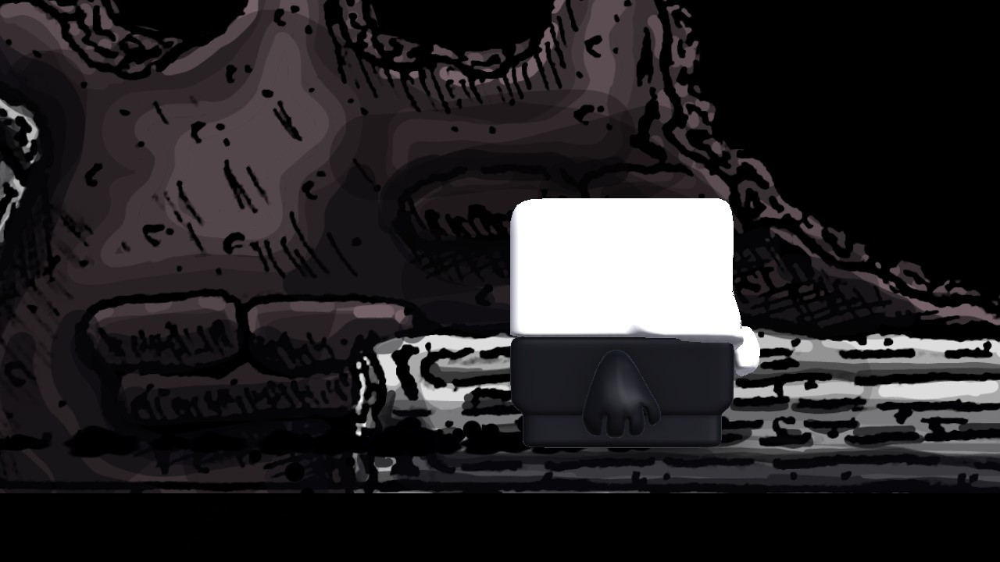
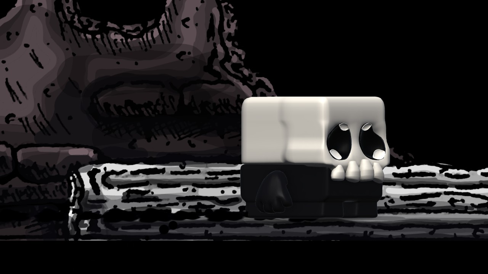

# Murther in the Limbo — Correcciones sugeridas

Revisión técnica del prototipo de **Five Star Studio** sobre `main` (`0dea7b8`). Este README describe **solo los cambios de la rama `Correcciones-sugeridas`**. El reporte de avances del equipo está en [`Docs/ProyectoIntegrador_Avances_FiveStarStudio.pdf`](Docs/ProyectoIntegrador_Avances_FiveStarStudio.pdf).

Todo se hizo y verificó en **Unity 6000.3.23f1**: compilación sin errores ni advertencias, pruebas automáticas en Play Mode (entrada, física de Murther, Build Settings y carga de escenas) y capturas desde las mismas vistas en las dos versiones. **Falta probarlo con un control físico, jugarlo de principio a fin a mano y compilar el ejecutable.** Cada commit corresponde a un bloque, así que cualquiera se puede revisar o revertir por separado.

| Commit | Bloque |
|---|---|
| `5f05e40` | 1. Proyecto: render pipeline, entrada, Build Settings, nombre y `.gitignore` |
| `9350745` | 2. Herramientas de editor que regeneraban escenas solas |
| `c92da21` | 3. Flujo y menú |
| `e09f147` | 4. Ajustes visuales |
| *(último)* | 5. Documentos en `Docs/` y este README |

## Comparación con `main`

Capturas renderizadas en Unity, en Play Mode, a 1280×720, con el mismo recorrido en las dos versiones: Murther avanza 4 s a la derecha y hace doble salto.

| `main` (original) | `Correcciones-sugeridas` |
|---|---|
| **Nivel 1 al iniciar** | |
|  |  |
| **Nivel 1 corriendo (aparece un Corredor)** | |
|  |  |
| **Doble salto en la orilla derecha** | |
|  |  |
| **Nivel 2** | |
|  |  |
| **Nivel 3** | |
|  |  |

En `main` los niveles se ven **negros** y Murther **magenta**: el proyecto no tenía asignado el render pipeline URP (bloque 1). El menú, que es solo interfaz, se ve igual en las dos versiones.

Para separar ese error de los ajustes visuales, aquí está Murther de cerca **solo con URP asignado** y con los ajustes del bloque 4:

| Solo con URP asignado | `Correcciones-sugeridas` |
|---|---|
|  |  |
|  |  |

- **Cara:** de perfil estricto el casco de calavera es un rectángulo blanco. Girado 35° hacia la cámara se le ven los ojos y los dientes hacia los dos lados.
- **Luz:** antes el casco se quemaba en blanco puro. Ahora tiene volumen: la cara, el costado y la parte de abajo se distinguen.

## 1. Proyecto: render pipeline, entrada, Build Settings, nombre y `.gitignore`

Estos tres primeros errores hacían que el juego no funcionara al abrirlo en otra computadora.

| Cambio | Por qué |
|---|---|
| **URP asignado** (`GraphicsSettings` → `PC_RPAsset`) | No había ningún render pipeline asignado, así que Unity usaba Built-in. Los materiales de Murther (URP/Lit) salían **magenta** y los fondos (Sprite-Unlit-Default de URP) **no se dibujaban**. |
| **Active Input Handling → Input System** | Estaba en *Input Manager (Old)*, pero todos los scripts leen `Keyboard.current` y `Gamepad.current` del Input System nuevo. Esos valores eran `null` (0 dispositivos): **Murther no respondía** al teclado ni al control. |
| **Build Settings con las 8 escenas** | La lista estaba vacía, así que `SceneManager.LoadScene` no encontraba ninguna escena y **"Iniciar Juego" dejaba la pantalla en negro**. Orden: MenuPrincipal → Cinematica → Controles_Nivel1 → Nivel1 → … → Nivel3. |
| `PlayerController3D` (prototipo anterior, en `Assets/Assets`) pasa al Input System | Usaba `Input.GetAxis`/`GetKey`, que fallan con el Input Manager desactivado. Se conservan las mismas teclas (y se agregan los botones del control) por si el equipo reutiliza el dash o el ataque. |
| Menús del prototipo anterior en **Juego → Prototipo anterior** | Se mezclaban con las herramientas actuales; *Poner fondo 2D* o *Poner mis modelos 3D* modificaban la escena abierta. |
| `productName` "Juego_Unity" → **"Murther in the Limbo"**; `companyName` → "Five Star Studio" | Es el nombre de la ventana y del ejecutable. |
| Se restaura el **`.gitignore`** de Unity (+ `.DS_Store`) | Se borró en el último commit de `main`. Sin él, la siguiente subida incluiría `Library/` (varios GB), `Logs/` y `UserSettings/`. |
| `unity-mcp` fijado a un commit | Seguía la rama `main` del repositorio: cada integrante podía bajar una versión distinta del paquete. |

## 2. Herramientas de editor que regeneraban escenas solas

`ConstruirFlujoDelJuego` y `ConfiguradorFase1` tenían `[InitializeOnLoadMethod]` y guardaban la marca de "ya se ejecutó" en `EditorPrefs`, que **es local a cada computadora**. La primera vez que alguien abría el proyecto en otra máquina:

- `ConstruirFlujoDelJuego` **volvía a crear todas las escenas desde cero**, incluidos los niveles sin Murther, sin suelo y sin enemigos.
- `ConfiguradorFase1` borraba y recreaba el Animator Controller, los materiales y a Murther con **GUIDs nuevos**, y rehacía las pantallas de carga.

Se perdían los cambios hechos a mano, y cada integrante podía subir versiones distintas de las mismas escenas.

| Cambio | Por qué |
|---|---|
| Las dos herramientas solo corren desde el menú **Juego** y **piden confirmación** | Ya no se ejecutan solas al abrir el proyecto. |
| *Construir flujo de escenas* ya no toca los niveles ni las pantallas de carga que existen; solo crea las que faltan | Antes sobrescribía el trabajo de *Fase 1* con niveles vacíos. |
| Nuevo **Juego → Registrar escenas en Build Settings** | Actualiza la lista sin regenerar nada. |
| Los generadores usan los mismos valores que el bloque 4 | Así volver a ejecutarlos no deshace las correcciones visuales. |

## 3. Flujo y menú

| Cambio | Por qué |
|---|---|
| `MenuPrincipalUI`: al abrir un panel se selecciona su primer botón (en *Salir*, "Cancelar") | Ningún botón quedaba seleccionado, así que **con control o con las flechas no se podía usar el menú**, aunque el juego está pensado para control (pantalla de carga). |
| `MenuPrincipalUI`: **Esc** o **B** cierran la ventana de salir y regresan de Créditos | Solo se podía salir de esas pantallas con el ratón. |
| `MenuPrincipalUI`: doble clic en "Iniciar Juego" ya no reinicia el fundido | |
| `BotonResaltado`: el ratón mueve la selección | Evita que queden dos botones resaltados a la vez (uno con el control y otro bajo el cursor). |
| `FlujoFader`: si una escena no está en Build Settings, avisa en la consola y vuelve a mostrar la escena actual | Antes la pantalla se quedaba **negra para siempre** y bloqueaba los clics. Era justo lo que pasaba en `main` al pulsar "Iniciar Juego". |
| `FlujoFader`: carga asíncrona y tope de 1/30 s por cuadro en el fundido | El cuadro largo que sigue a una carga se comía el fundido de entrada y la escena aparecía de golpe. |
| `IntroLogos`: cualquier tecla, clic, **A** o **Start** salta el video del logo | Había que verlo completo cada vez. |
| `CinematicaComic`: **Start** o **B** la saltan | Con control no había forma de saltarla; solo con Esc o con el ratón. |

## 4. Ajustes visuales

| Cambio | Por qué |
|---|---|
| `MurtherController`: nuevo **`giroHaciaCamara`** (35°) | De perfil estricto el casco de calavera se veía como un rectángulo blanco sin cara (ver capturas). Ahora se ven los ojos y los dientes hacia los dos lados, y al voltear pasa por el frente. Con 0 vuelve al perfil. |
| Luz del Nivel 1: 1.3 → **1.05**, cálida, desde el frente y arriba; ambiente plano 0.55 → **degradado** cielo/horizonte/suelo | La luz anterior, el ambiente plano y un casco casi blanco sumaban más de 1: la cabeza se **quemaba en blanco puro**. Además, la luz lateral iluminaba distinto según hacia dónde mirara Murther. |
| Material del casco: 93 % → **80 %** de blanco | Deja margen para que se vean la luz y la sombra. Los brillos de los ojos siguen al 93 %. |
| Paredes invisibles de los tres niveles **0.7 m hacia dentro** | El casco es más ancho que el collider: al llegar a la orilla, la mitad de Murther quedaba fuera de cuadro. |
| Fondos y arte del menú: **mipmaps** con filtro trilineal y compresión de **alta calidad** (BC7) | Los fondos miden ~3900 px y se muestran reducidos ~1.7× en 1080p. Sin mipmaps las líneas de tinta **parpadeaban** al mover la cámara, y la compresión normal (DXT) les ponía bloques. |
| `PC_RPAsset`: **MSAA 4×** | Estaba desactivado: los bordes 3D de Murther se veían dentados sobre el dibujo. |
| `MurtherController`: el estirado de respaldo respeta la escala original de `Visual` | Solo se usa si no hay hueso de cabeza; antes fijaba la escala Y en 1. |

**Para volver al perfil estricto:** en `Murther` → `MurtherController`, poner *Giro Hacia Camara* en 0.

## 5. Documentos

- `Readme.md` era una carpeta con el PDF de avances; ahora el PDF está en `Docs/`, para que `README.md` pueda ser un archivo (en macOS y Windows los dos nombres chocan).
- El video `WhatsApp Video 2026-11-12 at 5.13.23 PM.mp4` de la raíz pasó a `Docs/Video_avance_2026-11-12.mp4`.

## 6. Cómo probar

1. `git switch Correcciones-sugeridas` y abrir el proyecto con Unity 6000.3.23f1. **No** debe aparecer ningún diálogo ni regenerarse ninguna escena.
2. Abrir **MenuPrincipal** y dar Play:
   - El logo se salta con cualquier tecla.
   - Con flechas o control: navegar el menú, abrir **Créditos** y regresar con Esc/B, abrir **Cerrar Juego** y cancelar.
   - **Iniciar Juego** → cinemática (se salta con el botón, Esc, Start o B) → pantalla de carga → Nivel 1.
3. En el **Nivel 1**: moverse con A/D, flechas o stick; saltar con Espacio, W o A del control; doble salto en el aire. Llegar a las dos orillas: Murther debe verse completo.
4. Ajustar a gusto *Giro Hacia Camara* (`MurtherController`) y la luz (`Luz Direccional` y *Lighting → Environment* del Nivel 1).

## 7. Pendientes para el equipo (no aplicados)

Son decisiones de contenido o de diseño, así que se dejaron como estaban:

- **Textos de relleno en `TextosJuego.cs`:** frases de los niveles 2 y 3 (`[PDF] …`), integrantes en los créditos y las 6 páginas `[Cómic] Página N`. La cinemática dura 1:30 mostrando ese texto porque `paginas` está vacío.
- **Música y sonido:** existe `Assets/Musica.meta` pero no la carpeta, y el `AudioSource` del menú no tiene clip.
- **Niveles 2 y 3** no tienen a Murther, y **ningún nivel tiene final:** faltan meta, llaves, puerta, Game Over (los videos de `Cinematicas GameOver/` no se usan), vida, daño y combate.
- **Controles anunciados que no existen:** la pantalla de carga muestra *Ataque ligero/Interactuar* y *Recargar*, y `TextosJuego.Controles` menciona *Esquivar (Shift/J)* y *Atacar (K/X)*. El dash y el ataque están en el prototipo anterior (`PlayerController3D`), no en `MurtherController`.
- **No hay pausa ni forma de volver al menú** desde un nivel.
- **Prototipo anterior (`Assets/Assets/`, ~2400 líneas):** ninguna escena lo usa. Conviene decidir si se integra (vida, enemigos, flechas) o se borra.
- **Doble salto:** la cabeza sube 1.15 m y deja un hueco grande respecto al cuerpo. Si no es el efecto buscado, bajar *Altura Cabeza* en `MurtherController`.
- **La tinta casi no se ve** sobre las zonas oscuras del fondo: es negra sobre negro. Un borde más claro o un tono azulado la harían legible.
- `Juego → Fase 1` sigue creando el Animator Controller y los materiales con GUIDs nuevos cada vez que se ejecuta; solo debe usarse cuando haga falta rehacer a Murther.
- `SampleScene.unity` sobra, y los paquetes `com.unity.ai.assistant` (pre) y `com.unity.pipeline` (experimental) son versiones de prueba.
